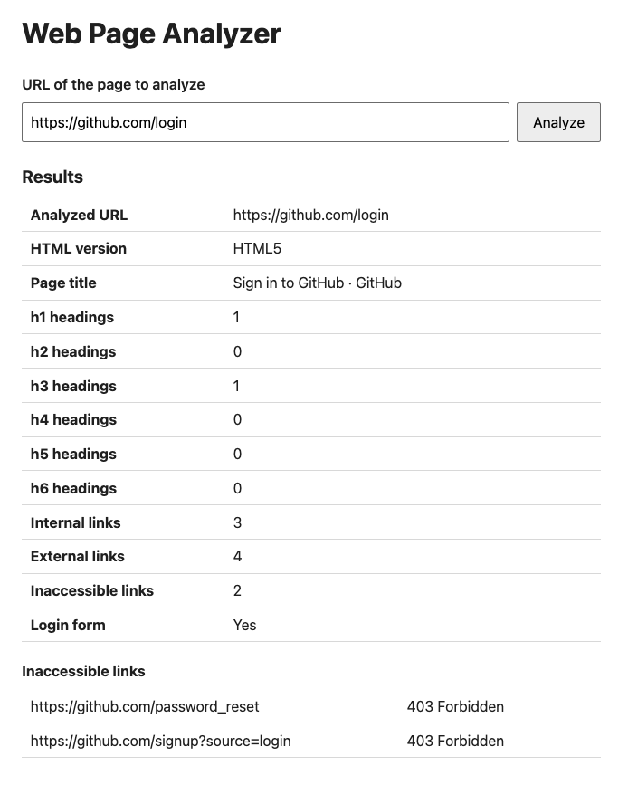
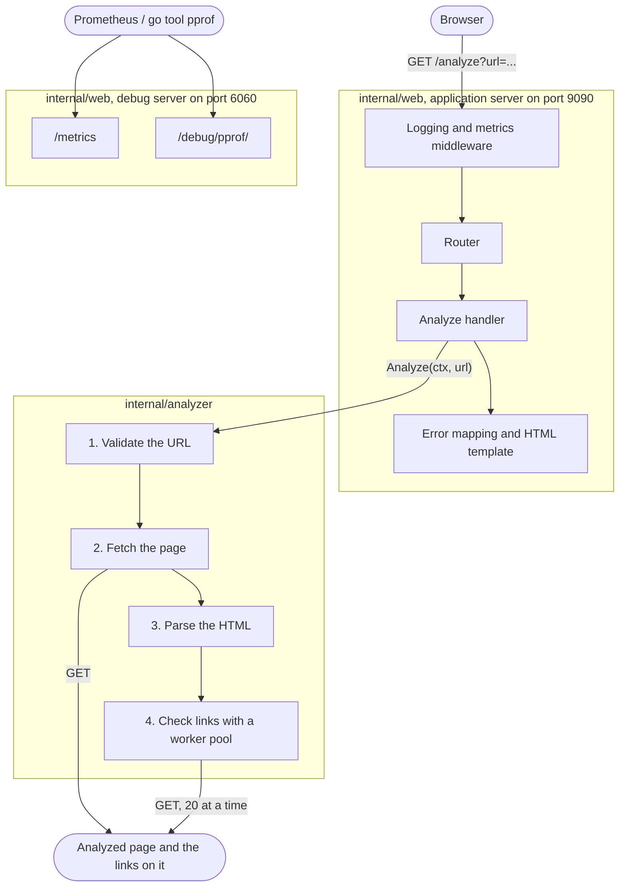

# Web Page Analyzer

A small Go web application that takes the URL of a web page and reports what
is on it. You enter a URL in a form, the server fetches the page, and the
result is shown on the same page.

For each page it reports:

- the HTML version
- the page title
- how many headings there are at each level (h1 to h6)
- how many internal and external links there are
- how many of those links are inaccessible, and which ones, with the reason
- whether the page has a login form

If the page cannot be analyzed, the form shows the HTTP status code and a
short description of what went wrong.

## Prerequisites

- Go 1.27 or later
- make (optional, the plain `go` commands are listed below as well)
- Docker (optional, only for running it in a container)

Developed and tested on macOS. The Docker image runs on Linux. It has not been
tested on Windows, where Docker is the safest way to run it.

## Technologies

Backend: Go, using the standard library for the HTTP server (`net/http`),
templates (`html/template`) and logging (`log/slog`).

Frontend: a single server-rendered HTML page with a little inline CSS. There
is no JavaScript.

DevOps: Makefile, multi-stage Dockerfile, Prometheus metrics, pprof.

## External dependencies

| Module | Used for |
| --- | --- |
| `golang.org/x/net` | HTML parser (`html`) and character set detection (`html/charset`) |
| `github.com/prometheus/client_golang` | Metrics and the `/metrics` endpoint |

Everything else in `go.mod` is pulled in indirectly by these two.

## Setup

Clone the repository and run it:

```
git clone https://github.com/isuruRuhu/web-page-analyzer.git
cd web-page-analyzer
make run
```

Then open http://localhost:9090.

Without make:

```
go build -o bin/server ./cmd/server
./bin/server
```

With Docker:

```
make docker-run
```

which is the same as:

```
docker build -t web-page-analyzer .
docker run --rm -p 9090:9090 -p 127.0.0.1:6060:6060 web-page-analyzer
```

### Configuration

The server is configured with environment variables.

| Variable | Default | Meaning |
| --- | --- | --- |
| `ADDR` | `:9090` | Address of the application |
| `DEBUG_ADDR` | `localhost:6060` | Address of the metrics and pprof server (`:6060` in the Docker image) |
| `LOG_LEVEL` | `info` | `debug`, `info`, `warn` or `error` |
| `ALLOW_PRIVATE_ADDRESSES` | `false` | Set to `true` to allow analyzing pages on localhost and private networks |

By default the server refuses to request localhost and private addresses (see
SSRF protection below). To analyze a page served on your own machine, start
it with `ALLOW_PRIVATE_ADDRESSES=true make run`.

### Make targets

| Target | What it does |
| --- | --- |
| `make build` | Builds `bin/server` |
| `make run` | Builds and starts the server |
| `make test` | Runs the tests with the race detector |
| `make cover` | Runs the tests and prints the total coverage |
| `make fmt`, `make vet` | `go fmt` and `go vet` |
| `make docker-build`, `make docker-run` | Builds the image, builds and runs it |
| `make clean` | Removes `bin` and the coverage file |

## Usage

Open the application, type a URL such as `https://example.com` and press
Analyze. The results appear in a table below the form. Analyzing a page with
many links can take a few seconds, because every link is requested.



There is one role only: anyone who can reach the page can analyze a URL. There
are no accounts.

### Endpoints

Application (port 9090):

| Route | Purpose |
| --- | --- |
| `GET /` | The form |
| `GET /analyze?url=...` | Analyzes the URL and shows the result or the error |
| `GET /healthz` | Returns `ok`, for health checks |

Debug server (port 6060):

| Route | Purpose |
| --- | --- |
| `GET /metrics` | Prometheus metrics |
| `GET /debug/pprof/` | pprof profiles |

The debug server is separate so that profiles and metrics are not exposed on
the public port.

### Errors

| Situation | Shown to the user | Our response status |
| --- | --- | --- |
| The URL is empty or not a valid http/https URL | 400 Bad Request, with what is wrong with the URL | 400 |
| The page answered with an error, e.g. 404 | The page's own status code, e.g. 404 Not Found | 502 |
| The host cannot be reached (DNS, refused connection, TLS) | 502 Bad Gateway, with the reason | 502 |
| The page took too long | 504 Gateway Timeout | 504 |
| The URL points to localhost or a private address | 403 Forbidden | 403 |
| The URL is not an HTML page, e.g. an image | 422 Unprocessable Entity | 422 |

### Metrics

`/metrics` also contains the usual Go runtime and process metrics. The ones
this application adds are:

| Metric | Labels | Meaning |
| --- | --- | --- |
| `http_requests_total` | method, route, status | Requests handled |
| `http_request_duration_seconds` | route | How long requests took |
| `page_analyses_total` | outcome | Analyses by outcome: `ok`, `invalid_url`, `bad_status`, `unreachable`, `timeout`, `not_html`, `blocked`, `canceled`, `error` |
| `page_analysis_duration_seconds` | | How long analyses took |

To see only these:

```
curl -s localhost:6060/metrics | grep -E '^(http_|page_)'
```

## Architecture

The application is one Go binary with three packages. There is no database
and nothing is stored between requests.



The analyzer returns a `Result` or a typed error to the handler, which
renders it into the page sent back to the browser.

### Packages

```
cmd/server          main: configuration, the two HTTP servers, graceful shutdown
internal/analyzer   fetching a page, parsing it, classifying and checking links
internal/web        handlers, middleware, metrics, the HTML template
```

`cmd/server` builds the pieces and connects them: the logger, the HTTP
client, the metrics registry, the analyzer and the two servers. It is the only
place that reads environment variables.

`internal/analyzer` knows nothing about HTTP handlers or HTML pages. It takes
a URL and returns a `Result` or a typed error. Its files follow the steps
above: `url.go` (validation), `analyzer.go` (fetch), `parse.go` and `links.go`
(reading the document and classifying links), `check.go` (the link checker),
`client.go` (the HTTP client with SSRF protection) and `errors.go`.

`internal/web` is the only package that deals with requests and responses. It
turns a `Result` into the page and an error into a status code and message.

The dependency goes one way: `web` imports `analyzer`, never the other way
round. Both packages are under `internal/` because they are not meant to be
imported by other modules.

### What happens on a request

1. The browser sends `GET /analyze?url=https://example.com`.
2. The logging and metrics middleware note the start time and pass the
   request to the router, which calls the analyze handler.
3. The handler calls `Analyze` with the request's context, so the work stops
   if the user closes the tab.
4. The analyzer validates the URL, fetches the page (following redirects) and
   parses it in a single pass over the document.
5. The link checker removes duplicate links and hands the rest to 20 workers
   over a channel. Each worker requests its link and sends back the outcome.
   When all workers are done the outcomes are added up.
6. The handler renders the result, or the error, into the template and writes
   the response. The middleware then records the status and duration.

### Concurrency

Every incoming request runs in its own goroutine, which `net/http` does by
default. The analyzer has no shared mutable state, so any number of analyses
can run at the same time. Inside one analysis, the link check is the only
concurrent part: a fixed pool of workers, a jobs channel, a results channel
and a `sync.WaitGroup`. The limits are described under Assumptions.

## Tests

```
make test
make cover
```

Coverage is 98.7% for `internal/analyzer` and 100% for `internal/web`, 88%
in total. `cmd/server` only wires things together and has no tests.

The tests do not use the internet. Pages and links are served by
`net/http/httptest` servers on the local machine, and failures such as DNS
errors and timeouts come from a fake transport. The handler tests run the
real analyzer against those test servers, so they cover the path from the
HTTP request to the rendered page.

There are no integration tests against real websites, since they would be
slow and would fail whenever a site changes. I tested against real sites by
hand (for example `https://example.com` and `https://github.com/login`). An
automated end-to-end test of the Docker image is listed under improvements.

## Assumptions and decisions

HTML version
- It is taken from the doctype. `<!DOCTYPE html>` is HTML5; the older HTML
  and XHTML doctypes are recognized by their public identifier.
- A page with no doctype is reported as "Unknown (no doctype)".

Headings
- All six levels are always listed, with 0 for levels that are not used.

Links
- Only `<a href>` elements count. `mailto:`, `tel:`, `javascript:` and other
  non-http links are ignored.
- Relative links are resolved against the final URL after redirects, or
  against `<base href>` if the page has one.
- A link is internal if it points to the same host as the page. `www.` and
  upper/lower case are ignored, so `example.com` and `www.example.com` are
  the same site. Other subdomains (`blog.example.com`) count as external.
- Every occurrence is counted. If the same link appears three times, it
  counts three times, also in the inaccessible count.

Inaccessible links
- A link is inaccessible if the request fails or the final status is 400 or
  above. Redirects are followed.
- Each different URL is requested once, with GET. HEAD would be cheaper, but
  many sites answer HEAD with 403 or 405 for pages that work fine.
- Links are checked concurrently by 20 workers. Each link gets 5 seconds and
  the whole check 30 seconds.
- The inaccessible links are listed below the results, each once, with the
  status code or the reason the request failed.
- At most 500 different links are checked per page. Links that were not
  checked because of this limit or the 30 seconds are shown in a separate
  "Unchecked links" row, so they are not reported as broken.

Login form
- A page has a login form if it contains a `<form>` with exactly one password
  field. Two or more password fields is usually a sign-up or change-password
  form.

Fetching
- Only http and https URLs are accepted.
- The first 10 MB of a page are read.
- Only pages served as `text/html` or `application/xhtml+xml` are analyzed.

SSRF protection
- The server fetches URLs chosen by the user, so without a guard it could be
  used to reach services on its own network, such as `http://localhost:6060`
  or a cloud metadata address like `169.254.169.254`.
- The HTTP client refuses to connect to loopback, private, link-local and
  other non-public addresses, for IPv4 and IPv6.
- The check runs on the resolved IP address just before each connection is
  made, not on the URL text. That way it also applies to redirects, to every
  link that is checked, and to host names that resolve to a private address.
- A blocked page gives a 403 with an explanation. A blocked link on an
  otherwise public page counts as inaccessible.
- `ALLOW_PRIVATE_ADDRESSES=true` turns the guard off for local testing.

## Challenges

### Deciding what "inaccessible" means

A link that works in a browser can still fail for a server-side client. HEAD
requests are one case (see above). Sites with bot protection are another: on
`https://github.com/login` two links answer 403 to anything that is not a real
browser. I kept the simple rule (status 400 or above) and documented it as a
limitation, because guessing which 403s are "real" would be worse.

### Keeping the link check bounded

A page can have thousands of links and some of them hang. A fixed worker pool
with a per-link timeout, an overall timeout and a limit on the number of links
keeps one analysis within a known time and number of connections. The harder
part was the edge: when the overall time runs out, the remaining links must
not be counted as broken, which is why there is a third "unchecked" state.

### Internal or external

Comparing host names as plain strings gets `Example.com`, `www.example.com`
and `example.com:443` wrong. I normalize the host and ignore port and scheme.
Links with no host at all, such as `http:///path`, had to be dropped
explicitly.

### What html.Parse does to broken HTML

The parser repairs documents the way browsers do, and that has side effects: a
byte order mark hides the doctype, an `<svg>` can contain its own `<title>`,
and a `<form>` placed directly inside a `<table>` is closed before its inputs.
The first two are handled. The third is a known limitation.

### Errors that are useful to the user

"Something went wrong" is not enough, so the analyzer returns typed errors
(invalid URL, bad status, unreachable, not HTML) and one function maps them to
the status code and message. The same function names the outcome for the
metrics, so the two stay in sync.

## Known limitations

- Pages that build their content with JavaScript are analyzed as the server
  sends them. Links, headings and login forms added by scripts are not seen.
- Sites that block non-browser clients or rate limit (403, 429) make working
  links show up as inaccessible.
- A login form whose inputs are tied to it with the `form` attribute, or
  that sits directly inside a `<table>`, is not detected.
- There is no rate limiting, so one client can start many analyses at once.

## Possible improvements

- Rate limit analyses per client and limit how many run at once.
- Limit concurrent link checks per host and retry on 429, to be gentler on
  the sites and get fewer false "inaccessible" results.
- Cache results for a short time, so analyzing the same page twice does not
  repeat all the requests.
- A JSON API next to the HTML page.
- Render pages in a headless browser to support JavaScript-built pages.
- Link-check metrics (links checked by result).
- An end-to-end test that starts the Docker image and analyzes a page served
  by a second container, run in CI.
